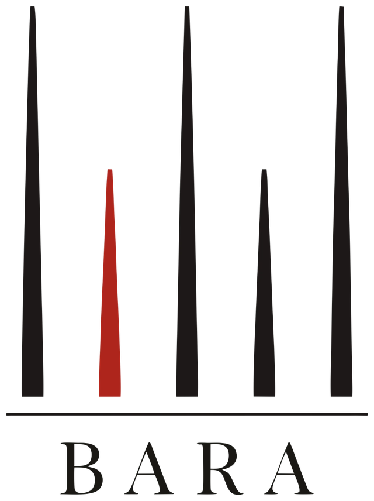

<p align="center">
  <picture>
    <source media="(prefers-color-scheme: dark)" srcset="web/brand/bara-logo-light.png">
    
  </picture>
</p>

# Bara

*Bara* is Indonesian for embers: peat fires smoulder underground like embers. Bara is a
next-day fire forecast and crew dispatch planner for Indonesia's peatland fires.
Built for the Meta Global AI Developer Hackathon (Oct 26 - Nov 4, 2026).

**Hackathon contribution:** all code in this repository was written during the hackathon,
starting Oct 26, 2026. No earlier project code is reused.

## What it does

A fire brigade commander asks four questions each morning. Bara answers them:

| Step | Question | Status |
|---|---|---|
| 1. Detect | Where was each fire first seen? | Working (`src/detect.py`) |
| 2. Forecast | Which fires will grow tomorrow? | Working, validated on 2019 (`src/train_eval.py`) |
| 3. Triage | Which need a brigade now? | Working, replayed on 2019 (`src/triage.py`) |
| 4. Dispatch | In what order should crews go? | Working, replayed on 2019 (`src/dispatch.py`) |

Meta's models do the parts that need language and vision, never the numbers:

| Meta model | Job in Bara | Code |
|---|---|---|
| Muse Spark 1.3 | Daily briefing: picks and calls 6 tools, writes the briefing; every number, tier, province and crew order is checked against the tool output | `src/agent.py` |
| Muse Spark 1.3 | "Ask Bara": answers a commander's questions and what-ifs by re-running the dispatch solver with new crew settings, answers ground-checked | `src/chat.py` |
| Muse Spark 1.3 (vision) | Field photo reports: says what a ranger's photo shows; Bara's rules then match it to the plan | `src/reports.py` |
| Muse Spark 1.3 (vision) | Map self-check: reviews a snapshot of the live map against the plan (advisory) | `src/selfcheck.py` |
| SAM 3.1 | Finds rivers (water for pumps) near each crew stop in Sentinel-2 images | `src/water.py`, `src/sam.py` |

"Earliest detection" is not the ignition point: satellites pass only a few times a day,
so the real start is earlier and possibly elsewhere. It is evidence, not blame.

## Setup (Windows, Git Bash)

```bash
python -m venv .venv
.venv/Scripts/python -m pip install -r requirements.txt
cp .env.example .env   # then add your keys
```

## Data

| Data | Source |
|---|---|
| Hotspots 2012-2025 | NASA FIRMS VIIRS S-NPP yearly country files, `https://firms.modaps.eosdis.nasa.gov/data/country/viirs-snpp/{year}/viirs-snpp_{year}_Indonesia.csv` |
| Rainfall 2011-2026 | CHIRPS v2.0 daily, 0.25 deg (`.../global_daily/netcdf/p25/`) and 0.05 deg region subset via `src/chirps_fine.py`, from `https://data.chc.ucsb.edu/products/CHIRPS-2.0/`. Final CHIRPS ends Sep 30, 2026 in our download |
| Peat extent | Global Forest Watch "Global peatland extent" v20230315 (CC BY 4.0; Miettinen et al. 2016 and Gumbricht et al. 2017 for Indonesia), read from public map tiles at zoom 9 |
| Drought Code | Copernicus CEMS `cems-fire-historical-v1` on EWDS (CC BY 4.0), 0.25 deg daily, via `src/drought.py`. Download in progress: the EWDS queue allows about 2 requests per user and each waits hours |
| Places, crew bases | GeoNames Indonesia dump and province codes (CC BY 4.0), `https://download.geonames.org/export/dump/` |
| Satellite images | Copernicus Sentinel-2 L2A true colour (10 m) from the Earth Search STAC catalogue, `https://earth-search.aws.element84.com/v1` (AWS open data, no key) |

Raw data goes in `data/raw/` and is not committed.

## Forecast data

Each day, candidate cells (0.01 deg, ~1.1 km) are those within 2 cells of any detection in the
last 7 days. The label is whether the cell has a detection the next day. Fires that start far
from any recent fire are outside this set: candidates covered 72.9% of next-day fire cells in
2019 and 64.5% in the training years. The rest need a separate new-ignition model.

```bash
.venv/Scripts/python src/peat.py
.venv/Scripts/python src/labels.py --years 2019
.venv/Scripts/python src/labels.py --years 2012-2018 2020-2022 --neg-frac 0.1 --name samples_train
.venv/Scripts/python src/features.py samples_2019_2019
.venv/Scripts/python src/features.py samples_train
```

## Forecast results (2019 validation)

Scored on all 9.1M candidate cell-days in 2019 (113,469 burn the next day). 2019 was also used
for early stopping and threshold choice, so these numbers are slightly optimistic; the held-out
2023 season is the real test.

| Model | AP | AP (new cells) | F1 | Area ratio | P@20 per day |
|---|---|---|---|---|---|
| Yesterday's fires (cell) | 0.191 | 0.006 | 0.320 | 1.37 | 0.382 |
| Yesterday's fires (3x3) | 0.207 | 0.038 | 0.308 | 0.91 | 0.337 |
| Dryness only (-rain 30d) | 0.015 | 0.007 | 0.033 | 33.7 | 0.004 |
| Logistic regression | 0.286 | 0.040 | 0.353 | 0.93 | 0.422 |
| LightGBM, hotspot features | 0.306 | 0.052 | 0.375 | 0.85 | 0.447 |
| LightGBM + peat + rain | 0.308 | 0.051 | 0.376 | 0.90 | 0.448 |

- LightGBM beats the best persistence baseline by 0.10 AP (0.308 vs 0.207).
- A weather-only dryness score is nearly useless at this scale (AP 0.015).
- Fires in cells with no detection in the last 7 days stay hard to predict (AP about 0.05).
- These metrics cover candidate cells only (72.9% of next-day fire cells in 2019).

### Does peat and rain (hydrology) help?

Ablation: the same LightGBM with and without peat share and rainfall history.

| Task (2019) | Best baseline AP | Without hydrology | With hydrology |
|---|---|---|---|
| Spread, next day | 0.207 | 0.306 | 0.308 |
| Spread, next 3 days | 0.192 | 0.293 | 0.297 |
| Spread, next 7 days | 0.180 | 0.289 | 0.297 |
| New fire in a quiet 11 km cell, next day | 0.028 | 0.055 | 0.057 |
| ... where no fire within ~33 km for 30 days | n/a | 0.0047 | 0.0055 |
| ... while the region is nearly inactive (<50 detections) | n/a | 0.0095 | 0.0109 |

- Peat and rain carry real signal on their own: in the new-fire task, a model with only peat,
  rain and day of year reaches AP 0.025, 4.6x the base rate (0.0055).
- But recent fire activity nearby already contains most of that signal, so the added value is
  small for next-day spread and grows with the horizon (+0.002 AP at 1 day, +0.008 at 7 days).
- Hydrology helps most where there is no fire activity to learn from (+15-17% AP in quiet
  areas), i.e. early in the season, which is when prevention patrols matter most.
- Better rain data does not change this. AP with hydrology, by rain source:

| Rain input | Spread, next day | Spread, next 7 days | New fire, next day |
|---|---|---|---|
| None (no peat or rain) | 0.306 | 0.289 | 0.055 |
| CHIRPS 0.25 deg, 2-day lag (default) | 0.308 | 0.297 | 0.057 |
| CHIRPS 0.05 deg, 2-day lag | 0.308 | 0.298 | 0.058 |
| CHIRPS 0.25 deg, no lag (upper bound) | 0.309 | 0.297 | 0.063 |

- Rain resolution is not the bottleneck. Rain timeliness matters only for new fires (today's
  rain suppresses tomorrow's ignitions), so a low-latency rain feed is worth it for that model.
- Not yet tested: groundwater level and the Copernicus Drought Code (download in progress).

The new-fire model (`src/ignition.py`) covers the 27-35% of fires that start far from recent fires:

```bash
.venv/Scripts/python src/ignition.py --years 2019 --name ign_2019
.venv/Scripts/python src/ignition.py --years 2013-2018 2020-2022 --neg-frac 0.05 --name ign_train
.venv/Scripts/python src/train_eval.py --task ignition --train ign_train --valid ign_2019
```

```bash
.venv/Scripts/python src/train_eval.py --train samples_train_feat --valid samples_2019_2019_feat --target y
```

## Web app

```bash
.venv/Scripts/python -m uvicorn server:app --app-dir src --port 8600
```

Open `http://localhost:8600` (or `http://localhost:8600/?date=2019-08-20` for another day).
`src/server.py` serves a JSON API over the deterministic tools and the front end in `web/`
(MapLibre GL + deck.gl on a CARTO basemap, Fira Sans/Fira Code, no build step).

- **Map:** clusters coloured by tier (red P1, orange P2), crew routes with numbered stops,
  new-fire watch cells, field reports, and a switch that draws where fire actually appeared the
  next day (replay truth).
- **Briefing:** the Muse Spark briefing with its grounding result, token count and cost.
- **Crews:** each crew's visit order, arrival hours, nearest river with the SAM 3.1 mask, and
  the map self-check.
- **Ask Bara:** commander chat; what-if answers draw the changed routes in amber.
- **Field reports:** send a photo and a location (4 demo photos from Wikimedia Commons, credited
  in `web/samples/credits.json`; they are placed on crew stops for illustration only).
- **Evidence:** the 2019 replay results and model scores.
- **Replay 2019 season:** plays July to October day by day (precomputed by
  `src/replay_frames.py`), with a running tally of fire reached by Bara against "biggest fire
  first".

Muse Spark and SAM 3.1 run only on a button press; saved results and cached calls cost nothing.

## Run

```bash
.venv/Scripts/python src/detect.py --start 2019-09-01 --end 2019-09-30
```

Writes cluster tables to `data/processed/` and a map to `outputs/`.

## Triage and Dispatch

**Triage** (`src/triage.py`) gives every cluster a tier from its peat-weighted forecast risk:
risk = expected new cells tomorrow x (1 + peat share). P1 (brigade now) if risk >= 5, P2
(village fire watch) if risk >= 1, else P3 (monitor). The weights and cut-offs are policy
choices, kept in the open for a commander to change.

**Dispatch** (`src/dispatch.py`) sends one crew from each provincial capital (an assumed base
until real Manggala Agni base locations are added) with a 10-hour day, 30 km/h average speed,
a 1.4 route factor and 2 hours per visit (all assumptions). For each crew it picks the visit
order that covers the most P1 and P2 risk, solved exactly by dynamic programming over its 10
highest-risk clusters. The output is an order such as "Palangkaraya crew: C4, then C11, then C2".
Visiting a fire is not putting it out: peat smoulders underground.

### Replay, Jul-Oct 2019 (123 days)

Plans use only that day's data; they are scored on which clusters had new fire cells the
next day (`src/replay.py`, `outputs/replay_20190701_20191031.md`).

| Triage | Share of clusters | Next-day new fire cells inside (forecast) | Same tier sizes, ranked by detections today |
|---|---|---|---|
| P1 | 1.3% | 35.3% | 33.6% |
| P1 + P2 | 6.8% | 57.9% | 52.1% |

| Dispatch plan | Visits | Next-day new fire cells reached | Share of oracle (peat-weighted) |
|---|---|---|---|
| Forecast + exact solver | 1,749 | 13,460 | 80.4% |
| Forecast + greedy (most risk per hour) | 1,617 | 12,862 | 76.6% |
| Biggest fire today first (no forecast) | 2,218 | 11,632 | 67.5% |
| Nearest fire first (no forecast) | 3,372 | 4,350 | 25.4% |
| Oracle (knows tomorrow) | 2,380 | 17,461 | 100.0% |

- The forecast plan reaches 15.7% more next-day fire cells than "biggest fire today first"
  (19.0% peat-weighted), with fewer visits. It does at least as well on 74.8% of days.
- Most of that comes from the forecast (greedy vs biggest-first: +10.6%); the exact solver adds
  4.6% over greedy.
- All plans keep crews on their base's island (added Oct 27; before it, totals differed by at
  most 11 cells, e.g. solver 13,466).
- Same caveat as the forecast: 2019 was the early-stopping year. The 2023 replay is the real test.

## Water sources with SAM 3.1

Crews pump water from rivers and canals. For each stop on the top crew routes,
`src/water.py` takes the clearest recent Sentinel-2 image around the cluster (`src/imagery.py`,
10 x 10 km at 10 m), segments it with SAM 3.1 (`src/sam.py`, Meta Model API, parsed with Meta's
`meta-sam-parser`), and reports the nearest river: distance, direction and position. Each
mask overlay is saved in `outputs/water/` for the demo map.

What worked and what did not (Oct 27 tests, all on the same chips):

| Prompt or setting | Result |
|---|---|
| "river", full 10 km chip | Found wide, light rivers (Kahayan at Palangkaraya, confidence 0.65); missed a wide orange river |
| "waterway", full chip | Found that orange river (0.51) |
| "river" on each 5 km quarter | Found a dark peat ("blackwater") river the full chip missed (0.82) |
| "canal", "drainage ditch", "road", "water", "lake", "stream", "black river", "muddy river" | Nothing, even on 2x zoomed crops of a plantation with many visible canals |

- The tool therefore runs "river" and "waterway" on the full chip and "river" on each quarter
  (6 calls, $0.015 per stop, cached after the first run).
- On 15 Sept 2019 it found a river near 3 of 7 crew stops (3.8 to 5.7 km away). By eye, 3 of
  the other 4 chips have no visible river; the fourth (C1) has a small winding river SAM missed.
- Drained peat is cut by canals a few metres wide, below what SAM can see at 10 m. So this is a
  river hint for crews, not the canal map first planned. Canal mapping would need sub-metre
  imagery.
- Image quality: the Sentinel-2 cloud mask labels fire-season smoke as "bare soil" (98.9% of
  one hazy chip), so chips with more than 20% bright pixels are rejected as haze.

## Muse Spark briefing agent

`src/agent.py` gives Muse Spark (`muse-spark-1.3`, Meta Model API) six deterministic tools
from `src/tools.py`: `detect_clusters`, `forecast_spread`, `forecast_new_fires`,
`triage_clusters`, `plan_dispatch` and `find_water_sources` (SAM 3.1). The model picks the
tools, reads their JSON and writes the briefing (in English for the hackathon). It does not
compute the forecast, the tiers, the routes or the water sources.

```bash
.venv/Scripts/python src/tools.py --date 2019-09-15   # tools only, no API calls
.venv/Scripts/python src/agent.py --date 2019-09-15   # full agent run
```

Each final answer goes through two checks before it is accepted:

- **Schema:** the reply must be one JSON object matching a pydantic model (clusters, new-fire
  cells, briefing, caveats).
- **Grounding:** each cluster's numbers, tier and province must equal the tool values, each
  crew route must match the solver's order, every number in the text must match a tool number
  at the precision written (68.5 or 74.2% are accepted for 68.5 and 0.742; "about 75" is not;
  Indonesian number style is also accepted), and every province named must appear in a tool
  output. Failures are sent back for one repair. Numbers written as words are not checked, so
  the prompt asks for digits.

Cost control (`src/llm.py`), since the Meta API budget is $150 in total:

- Every call is logged to `logs/meta_usage.jsonl` with tokens, reasoning tokens and cost at
  list price ($1.25 input, $0.15 cached input, $4.25 output per 1M tokens).
- A call is refused if its worst-case cost would push logged spend past `META_SPEND_CAP_USD`
  (default $20).
- Responses are cached in `cache/meta/`, so a repeated run costs $0 and replays without a key.

English briefing, 2019-09-15: 2 Muse Spark calls (all six tools requested in the first),
checks passed with no repair, $0.037 (the 42 SAM calls were already cached; uncached they add
$0.105). An earlier run used 4,205 of 5,537 output tokens on reasoning, so the agent asks for up
to 8,000 tokens and retries a cut-off reply once at 16,000.
Output: `outputs/briefing_20190915.md` and `.json` (with tool trace and per-call cost).

## Ask Bara (what-if chat)

`src/chat.py` gives Muse Spark four tools: `situation`, `cluster_details`, `list_bases` and
`what_if_dispatch`. The last one re-runs the exact solver with a different crew setup (crews at
a named base, crews everywhere, bases removed, day length, speed, time on site) and returns the
change against today's plan, so the model never computes a plan or a difference itself. The
answer must pass the same number check and may only name clusters that appear in tool output.

Example, 2019-09-15, "What if Palangkaraya had 2 crews instead of 1?": one call to
`what_if_dispatch(crews_at={"Palangkaraya": 2})`; risk covered goes from 562.8 to 649.9 (+87.1,
+15.5%), P1 clusters reached from 13 to 15, the second crew visits C7 then C6. 3 Muse Spark
calls, $0.022.

Found while testing: the first version of the tool only took one crew count for all bases, so
Muse Spark ran two different scenarios and mixed their results. Every number existed in some
tool output, so the number check passed. The tool now takes crews per base, and the question
maps to one scenario. The number check cannot catch numbers taken from the wrong scenario.

## Field photo reports

`src/reports.py`: Muse Spark (image input) returns one category (active flames, smouldering
peat, smoke only, burn scar, no fire, unclear) with the visible evidence. Bara's own rules then
match the report to the nearest cluster within 5 km and decide: confirm it, review it for
escalation to P1, add a fire the satellite has not seen, or flag a possible false alarm.

Test on 4 Wikimedia Commons photos (CC BY-SA 4.0), against my own reading of each photo:

| Photo | Muse Spark category (its confidence) | My reading |
|---|---|---|
| Crew hosing smoking ground | smouldering peat (0.9) | smouldering peat |
| Burned peatland | burn scar (0.9) | burn scar |
| Helicopter water-bombing over burned land | smoke only (0.75) | smoke over a burn, ambiguous |
| River landscape | no fire (0.98) | no fire |

4 calls, $0.022 in total. Four photos are a smoke test, not an accuracy measurement.

## Map self-check

`src/selfcheck.py`: the web app sends a snapshot of the live map (deck.gl drawn into the
MapLibre canvas), and Muse Spark checks it against the plan: routes match, no route crosses
water, high-risk P1 clusters no route reaches. Cluster ids and bases it names must exist in the
plan, or the finding is dropped.

First run, 2019-09-15 (1 call, $0.025): it correctly listed P1 clusters that no route reaches.
It also warned that the Pangkalpinang route crossed the Bangka Strait; checking the
coordinates showed all its stops are on Bangka island, so that warning was a false alarm. As
a safeguard anyway, the solver now only lets a crew serve clusters on its own island
(Sumatra, Kalimantan, Bangka-Belitung, Riau Islands), and the plan sent to the self-check
includes the island of every stop. The review is advisory: a person decides.

## Evaluation plan

Train on 2012-2018 and 2020-2022, tune on 2019, test once on the held-out 2023 El Nino season
against "yesterday's fires" and drought-index baselines.
