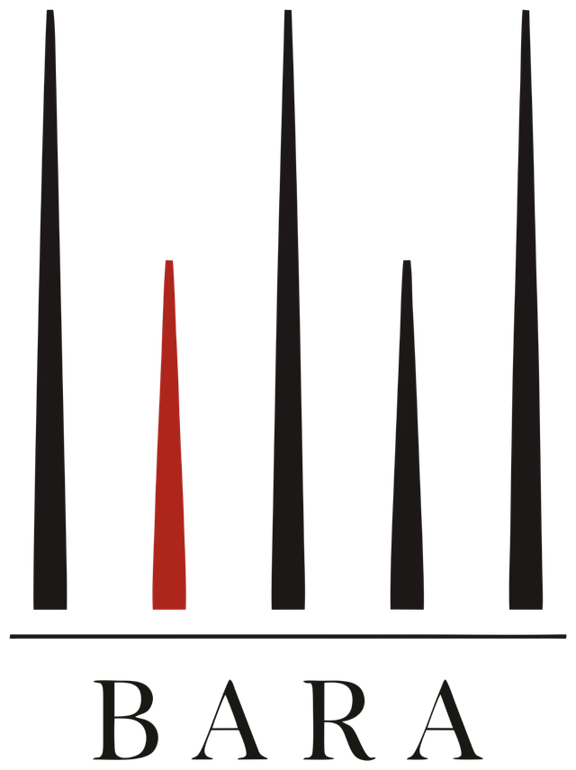

<p align="center">
  <picture>
    <source media="(prefers-color-scheme: dark)" srcset="web/brand/bara-logo-light.png">
    
  </picture>
</p>

# Bara

*Bara* is Indonesian for embers: peat fires smoulder underground like embers. Bara tells a fire
brigade commander, each morning, where peat fire is likely to spread tomorrow and which places
each crew should check today. Rangers and villagers answer back with a WhatsApp voice note, and
the plan changes.

**Live demo: https://bara-six-smoky.vercel.app** (forecast, crew routes and evidence; data up to
the last refresh, shown on the page). The actions that spend Meta API money (Ask Bara, written
briefings, photo and voice reports) and the WhatsApp field loop run only on the operator's machine,
so the public site cannot use up the budget and holds no phone numbers.

## Why it matters

2026 is Indonesia's worst fire season in over a decade
([Al Jazeera](https://www.aljazeera.com/news/2026/10/9/malaysia-shuts-schools-as-haze-from-indonesian-fires-chokes-southeast-asia)),
and it is not over. On 1 Nov 2026,
satellites recorded **555 fire detections** across Sumatra and Kalimantan, against 164 on a typical
day of 2026 (Bara's live data). A strong El Niño is expected to last until early 2027
([AFP/France 24, 28 Sep 2026](https://www.france24.com/en/live-news/20260928-the-wildfires-choking-indonesia-sparking-regional-haze)).

**People are dying now.**
- Fire smoke caused an estimated **3,560 deaths in Indonesia in September 2026 alone**, and about
  **57.8 million people** breathed unhealthy to hazardous air that month (CREA, short-term PM2.5
  exposure; [AFP/The Star, 30 Oct 2026](https://www.thestar.com.my/aseanplus/aseanplus-news/2026/10/30/fire-pollution-killed-3560-people-in-indonesia-in-september-report)).
  CREA's estimate for August was about 1,700
  ([Katadata, Sept 2026](https://katadata.co.id/ekonomi-hijau/energi-baru/6aa79bdd4fef2/crea-polusi-udara-ri-tewaskan-3700-orang-pada-agustus-1700-akibat-karhutla)).
  The government has not confirmed or rejected these figures.
- Indonesia's Health Ministry has recorded **more than 170,000 respiratory infections**
  ([Al Jazeera, 9 Oct 2026](https://www.aljazeera.com/news/2026/10/9/malaysia-shuts-schools-as-haze-from-indonesian-fires-chokes-southeast-asia)).

**The smoke crosses borders.**
- Malaysia closed schools in Kuala Lumpur, Putrajaya and five states on 9 Oct 2026, keeping about
  **2 million students** at home ([Al Jazeera](https://www.aljazeera.com/news/2026/10/9/malaysia-shuts-schools-as-haze-from-indonesian-fires-chokes-southeast-asia)).
  In August, nearly 600 schools in Sarawak closed and Kuching's air index hit 407, the region's
  worst haze since 2015 ([Al Jazeera, 1 Sep 2026](https://www.aljazeera.com/news/2026/9/1/toxic-haze-from-indonesian-fires-chokes-malaysian-borneo)).
- On 17 Oct 2026, Singapore was the world's second most polluted major city, with Kuala Lumpur
  third; ASEAN raised its haze alert to Level 3, the highest, and Timor-Leste closed schools
  ([AFP/France 24, 18 Oct 2026](https://www.france24.com/en/asia-pacific/20261018-months-long-indonesia-wildfires-spew-toxic-haze-across-southeast-asia)).

**The land and the animals.**
- Satellite estimates put the area burned from January to August 2026 at more than 637,000 ha
  (Auriga) to nearly 900,000 ha (Nusantara Atlas)
  ([France 24, 18 Oct 2026](https://www.france24.com/en/asia-pacific/20261018-months-long-indonesia-wildfires-spew-toxic-haze-across-southeast-asia)).
- Over 212,000 hotspots were detected inside peat ecosystems in the first eight months, more than
  double the count in 2015 (Pantau Gambut). Fires reached habitats holding 52% of Borneo's
  orangutans (IUCN), and 53 orangutans were among 100 animals rescued
  ([AFP/France 24, 28 Sep 2026](https://www.france24.com/en/live-news/20260928-the-wildfires-choking-indonesia-sparking-regional-haze)).

**It has happened before, and it costs.** One study estimates the 2015 haze caused about
**100,300 premature deaths** in Indonesia, Malaysia and Singapore (Koplitz et al. 2016;
[Harvard SEAS](https://seas.harvard.edu/news/2016/09/smoke-2015-indonesian-fires-may-have-caused-100000-premature-deaths)),
and the World Bank put that year's cost at **US$16.1 billion, 1.9% of GDP**
([World Bank, 2016](https://documents1.worldbank.org/curated/pt/776101467990969768/pdf/103668-BRI-Cost-of-Fires-Knowledge-Note-PUBLIC-ADD-NEW-SERIES-Indonesia-Sustainable-Landscapes-Knowledge-Note.pdf)).
Children exposed to the 1997 haze in the womb were shorter at age 17 (Tan-Soo and Pattanayak
2019, PNAS; [Duke](https://sanford.duke.edu/story/forest-fires-stunt-growth-cause-permanent-loss-human-potential/)).

Crews are few and peat fire hides underground, so the question each morning is where to send
them. Bara does not claim hectares, CO2 or lives saved: no source links a reached fire cell to
any of those, so any such number would be invented.

## What Bara does, today

Bara runs on this week's satellite data, not a past season. `src/live.py` brings 2026 up to the
last complete day: VIIRS detections from NOAA-20 (standard processing to Jul 31, near-real-time
after), rain from CHIRPS final, then CHIRPS preliminary, then NASA IMERG Early for the newest
days. On Nov 2 the live day was 2026-11-01, with rain to Oct 30 (the model uses a 2-day rain lag)
and the forecast for 2026-11-02. The build refuses to run if any rain day is missing.

The **Today** screen answers four questions in plain words:

| Step | Question | How |
|---|---|---|
| Detect | Where is fire burning now? | Satellite detections grouped into fire clusters (`src/detect.py`) |
| Forecast | Where will it spread tomorrow? | LightGBM on 0.01 deg cells with peat share and recent rain (`src/train_eval.py`), drawn on the map as "chance of fire tomorrow" |
| Triage | Which places need a crew now? | Peat-weighted risk: high (crew now), medium (village watch), low (`src/triage.py`) |
| Dispatch | In what order should each crew go? | Exact solver over each crew's 10-hour day (`src/dispatch.py`) |

It also shows yesterday's check: of the 200 spots Bara rated highest, how many burned the next day,
against the simple guess "where it burned yesterday".

### The field loop: WhatsApp voice notes change the plan

1. A ranger sends a voice note (or text, or photo) to the Bara WhatsApp number.
2. `src/whatsapp_routes.py` checks the Meta signature; `src/intake.py` downloads the audio,
   converts it to WAV and sends it to **Muse Voice Transcribe** with local place names as
   keywords.
3. **Muse Spark 1.3** turns the transcript into a `FieldReport` (fire state, place, area, smoke,
   access, people at risk, crew on site, needs). Every value must be backed by a quote from the
   transcript, or the report is marked for review (`src/field_report.py`, `src/report_schema.py`).
4. `src/geocode.py` finds the place in the GeoNames gazetteer (exact names only, no guessing).
   If a name is ambiguous, Bara accepts it only when one candidate is within 15 km of a fire;
   otherwise it asks "which one?".
5. `src/fusion.py` applies fixed rules: a report within 5 km of a cluster speaks for it
   (confirmed fire becomes high risk, smoke or a burn scar at least medium, "nothing here" low);
   a fire the satellite has not seen is added as a new high-risk stop. The solver re-plans and
   the route change is shown on the map.
6. `src/replies.py` sends one WhatsApp reply back to the reporter with what Bara understood and
   what changed.

Meta models perceive and write. They never set a tier, a route or a number: the forecast, rules,
solver and number checks are deterministic code.

## Meta AI in Bara

| Meta model | Job | Code |
|---|---|---|
| Muse Voice Transcribe | WhatsApp voice note to text, with place-name keywords | `src/transcribe.py` |
| Muse Spark 1.3 | Transcript to a structured, quote-backed field report | `src/field_report.py` |
| Muse Spark 1.3 | Morning briefing: calls Bara's 6 tools, writes the briefing; every number, tier, province and crew order is checked against the tool output | `src/agent.py` |
| Muse Spark 1.3 | "Ask Bara": what-if questions answered by re-running the solver | `src/chat.py` |
| Muse Spark 1.3 (vision) | Field photo category, and a self-check of the live map against the plan | `src/reports.py`, `src/selfcheck.py` |
| SAM 3.1 | Finds rivers (water for pumps) near crew stops in Sentinel-2 images | `src/water.py`, `src/sam.py` |
| Muse Spark 1.3 as a builder | Wrote 5 of Bara's modules from specs and tests (see below) | `src/build_with_spark.py`, `logs/builds/` |
| Muse Glimmer 30B (LoRA, Fireworks) | Experiment: a small open-weight report reader trained on Spark-verified examples | `src/glimmer_*.py`, `outputs/glimmer/` |

## Does it work?

Three pieces of evidence, strongest first. All the headline numbers below are printed from the
committed result files by `python eval/summary.py` (see [`eval/`](eval/README.md)).

## Held-out test: the 2023 season (pre-registered, run once)

The test was fixed before any 2023 data was touched: models frozen with SHA-256 hashes, thresholds
taken from 2019, two hypotheses and every metric written down in
[`PREREGISTRATION_2023.md`](PREREGISTRATION_2023.md) (committed Oct 28). It ran once on Oct 31
(`src/test_2023.py`); the results were committed unchanged in `c72fe55`
([`outputs/test_2023_log.md`](outputs/test_2023_log.md),
[`outputs/test_2023_results.json`](outputs/test_2023_results.json)). Nothing was tuned on 2023.

**H1, supported.** On all 7,082,796 candidate cell-days of 2023 (50,816 burn the next day), the
forecast's average precision is **0.162** against **0.099** for "yesterday's fires" (3x3). The 95%
interval of the gap, from 1,000 day-bootstrap resamples, is 0.054 to 0.071.

**H2, supported.** In a replay of Jul 1 to Oct 31, 2023 (123 days, one crew per provincial capital),
crews following the forecast and the exact solver reach **4,081** next-day fire cells against
**3,713** when they go to the biggest fire first: 9.9% more, with 1,122 visits instead of 1,974.

| Forecast, 2023 | AP | AP (new cells) |
|---|---|---|
| Yesterday's fires (cell) | 0.081 | 0.004 |
| Yesterday's fires (3x3) | 0.099 | 0.021 |
| Last 7 days (5x5) | 0.059 | 0.014 |
| Dryness only (-rain 30d) | 0.011 | 0.006 |
| Logistic regression (all inputs) | 0.155 | 0.028 |
| **LightGBM + peat + rain** | **0.162** | **0.032** |

| Dispatch, Jul-Oct 2023 | Visits | New fire cells reached | Share of oracle (peat-weighted) |
|---|---|---|---|
| Bara (forecast + exact solver) | 1,122 | 4,081 | 62.0% |
| Forecast + greedy | 1,060 | 3,853 | 58.2% |
| Biggest fire first | 1,974 | 3,713 | 54.1% |
| Nearest fire first | 2,847 | 1,110 | 15.6% |
| Oracle (knows tomorrow) | 1,837 | 7,189 | 100.0% |

What the test does not show, stated as plainly as the wins:

- **The inputs matter more than the model.** A logistic regression on the same inputs nearly
  matches LightGBM (0.155 vs 0.162).
- **New fires stay hard.** In cells with no recent detection, average precision is 0.032 for the
  spread model and 0.057 for the separate new-fire model.
- **Triage gains are small at the top.** P1 clusters hold 17.0% of next-day fire cells with the
  forecast and 16.3% when ranked by today's hotspots; the gain shows at P2 (21.2% vs 17.2%).
- **Coverage.** The model scores candidate cells near recent fire: 58.6% of 2023's next-day fire
  cells were candidates (72.9% in 2019). Fires far from any recent detection are outside its view.
- **2023 is harder than 2019** for every method (2019 validation AP 0.308 vs 0.207); the gap to the
  baseline is larger in 2023.
- **One satellite is not the whole story, but the ranking holds** with NOAA-20 detections as the
  truth instead of S-NPP: 0.148 vs 0.091.
- Reaching a fire means a crew checks it; it does not mean the fire is put out.

## Live check: the 2026 season so far (exploratory)

`src/scorecard.py` scores the same frozen forecast on every day of 2026 against what burned the
next day ([`outputs/live_scorecard.json`](outputs/live_scorecard.json)). It was not
pre-registered, and the inputs differ from training (NOAA-20 detections instead of S-NPP,
near-real-time rain), so it is a check, not a test.

- 2 Jan to 31 Oct 2026, 293 days, 10,976,894 candidate cell-days (167,056 burned the next day).
- Average precision **0.288** against **0.195** for "yesterday's fires" (3x3). The 95% interval of
  the gap, from 200 day-bootstrap resamples, is 0.085 to 0.105.
- Last 14 days (18 to 31 Oct): of the 200 spots each method rated highest, Bara had more that
  burned the next day on 11 days and fewer on 3. The app shows this table under "Does it work?".

## Muse Glimmer report reader (experiment)

Can a small open-weight Meta model do the transcript-to-report job, so it could one day run
offline? Muse Glimmer 30B was LoRA fine-tuned on Fireworks (training free during the promotion)
on 545 synthetic voice-note transcripts whose reports Muse Spark extracted correctly and our
checks verified. It was tested on 100 held-out synthetic rows with places not in training, with
the same deterministic grader (`src/report_grader.py`).

| Glimmer run | Valid JSON | All fields correct |
|---|---|---|
| Base model, no tuning | 0.00 | 0.00 |
| Tuned, 100 rows, 1 epoch | 1.00 | 0.71 |
| Tuned, 200 rows, 1 epoch | 1.00 | 0.92 |
| Tuned, 545 rows, 1 epoch | 1.00 | 0.99 |
| Tuned, 545 rows, 2 epochs | 1.00 | 0.96 |
| Tuned, 545 rows, 2 epochs, LoRA rank 16 | 1.00 | 1.00 |
| Tuned, 545 rows, 2 epochs, learning rate 2e-4 | 1.00 | 0.83 |
| Tuned, 545 rows, 3 epochs | 1.00 | 1.00 |

- The base model never produced a usable report: without a token limit it did not finish 69 of
  100 answers; with a 600-token limit it finished none.
- The test rows were kept only when Muse Spark got them right, so Spark scores 100% on them by
  construction, and the tuned runs saturate. This shows Glimmer learns the format and fields from
  a few hundred examples; it does not show it matches Spark on real speech. That needs the
  scripted real voice notes (`docs/recording_scripts.md`, gold answers in
  `outputs/glimmer/e1/gold.jsonl`), which are not scored yet.
- The live app keeps Muse Spark: serving a tuned Glimmer needs a paid deployment.

## Limitations

- **Reaching a fire is checking it, not putting it out.** All dispatch results count fire cells
  a crew reaches, nothing more.
- **New fires stay hard.** Fires far from any recent detection are mostly outside the forecast
  (2023 average precision 0.032 in cells with no recent fire).
- **Crew bases and speeds are assumptions**: one crew per provincial capital, 30 km/h, 2 hours
  per visit. Real brigade bases and travel times are not in the model.
- **Live inputs differ from training**: NOAA-20 instead of S-NPP, and live rain mixes CHIRPS
  preliminary and IMERG Early (training used CHIRPS final). The 2026 scorecard is how we watch
  for drift.
- **The field loop is English-first** and tested by one person on a WhatsApp test number;
  Indonesian and local languages are the next step. The webhook runs through a temporary tunnel
  on a laptop, not a hosted service.
- **Region:** Sumatra and Kalimantan only. Other regions in the picker are marked "in development"
  and need their own training data.

## Run it: quickstart

Works on Windows (Git Bash), Linux and macOS. On Linux and macOS use `.venv/bin/python` in place of
`.venv/Scripts/python`.

```bash
git clone https://github.com/ewenliam/bara-peat-fire.git
cd bara-peat-fire
python -m venv .venv
.venv/Scripts/python -m pip install -r requirements.txt
.venv/Scripts/python src/get_demo_data.py   # 120 MB download: the 2026 tables, no key needed
cp .env.example .env                        # then set META_API_KEY for the Meta features
.venv/Scripts/python -m uvicorn server:app --app-dir src --port 8600
```

Open `http://localhost:8600`. Use your own key from [dev.meta.ai](https://dev.meta.ai) and never
commit `.env`. `logs/meta_usage.jsonl` ships with this project's build spend, which counts against
`META_SPEND_CAP_USD` (20 by default), so raise the cap or start the file empty for your own testing.

| What you can try | Needs |
|---|---|
| Today screen, forecast, crew routes, "Does it work?", season replay, `python eval/summary.py`, tests | No key |
| Ask Bara, photo reports, written briefing (a first run for a new day takes about 5 minutes and about $0.22, because it fetches satellite images for SAM 3.1), and "Record a field report here" in the Field reports tab (Voice Transcribe and Muse Spark, same pipeline as WhatsApp; needs `ffmpeg` on your PATH) | `META_API_KEY` |
| The WhatsApp loop | WhatsApp Cloud API keys, `cloudflared`, `ffmpeg` (below) |
| Refreshing live data | `FIRMS_MAP_KEY`, `EARTHDATA_TOKEN` (below) |

The pack holds only 2026. Opening a 2019 or 2023 day needs those seasons' tables, which can be
rebuilt from the sources in the data sections below; their results are already in `outputs/`.
While models run, a "Meta model calls, live" panel under the tabs shows each call. Times in
the app are the machine's local time, except the live-data build time, which is marked UTC.

The full WhatsApp demo (server, Cloudflare quick tunnel, and the Meta webhook pointed at it;
needs `cloudflared` and `ffmpeg` installed and the WhatsApp keys in `.env`):

```bash
.venv/Scripts/python src/run_demo.py
```

Paid endpoints (briefing, chat, photo and voice uploads) answer only on localhost, never through
the tunnel.

Bring live mode up to the latest day, then rescore 2026:

```bash
.venv/Scripts/python src/live.py
.venv/Scripts/python src/scorecard.py
```

Tests (no API calls, no messages sent):

```bash
for t in tests/test_*.py; do .venv/Scripts/python "$t"; done
```

CI (`.github/workflows/ci.yml`) runs the same tests and `eval/summary.py` on every push, and
builds the Docker image.

Docker (the processed tables in `data/` are mounted, not baked in; mounting `logs/` keeps one
Meta API spend ledger, so the spend cap counts every call):

```bash
docker build -t bara .
docker run -p 8600:8600 -v "$(pwd)/data:/app/data" -v "$(pwd)/logs:/app/logs" --env-file .env bara
```

Public deployment on Vercel (no API keys; `deploy/vercel_bundle.py` copies only the tables the
public pages read, never `.env` or `data/whatsapp/`). After `src/live.py` and `src/scorecard.py`,
run this again to publish the new day:

```bash
.venv/Scripts/python deploy/vercel_bundle.py
cd build/bara && vercel deploy --prod
```

## Data and licences

| Data | Source | Licence or terms |
|---|---|---|
| Fire detections 2012-2025 | NASA FIRMS VIIRS S-NPP yearly country files | NASA data, open; NASA asks to be acknowledged ([Earthdata](https://www.earthdata.nasa.gov/learn/find-data/near-real-time/citation)). Acknowledgment: data from NASA FIRMS (LANCE, ESDIS) |
| Fire detections 2023 check and 2026 live | NASA FIRMS area API, VIIRS NOAA-20 standard and near-real-time | As above |
| Rain | CHIRPS v2.0 final and preliminary (UCSB Climate Hazards Center) | Public domain: copyright waived ([CHC](https://www.chc.ucsb.edu/data/chirps)) |
| Rain, newest days | NASA GPM IMERG Early daily V07 (GES DISC) | NASA data, free to the public ([GPM data policy](https://gpm.nasa.gov/data/policy)) |
| Peat extent | Global Forest Watch "Global peatland extent" v20230315 (Miettinen et al. 2016, Gumbricht et al. 2017 for Indonesia) | CC BY 4.0 |
| Drought Code (downloaded, not in the frozen models) | Copernicus CEMS `cems-fire-historical-v1` | CC BY 4.0 |
| Places, crew bases | GeoNames | CC BY 4.0 ([GeoNames](https://www.geonames.org/about.html)) |
| Country borders (to drop fires in neighbouring countries) | Natural Earth 10m | Public domain ([Natural Earth](https://www.naturalearthdata.com/about/terms-of-use/)) |
| Satellite images for SAM 3.1 | Copernicus Sentinel-2 L2A via Earth Search STAC | Free and open; contains modified Copernicus Sentinel data 2023-2025 ([licence](https://ecds.ecmwf.int/licences/ec-sentinel)) |
| Basemap | CARTO tiles on OpenStreetMap data | © OpenStreetMap contributors, © CARTO; CARTO basemaps are free for non-commercial use ([CARTO](https://www.carto.com/basemaps/apikey/)) |
| Demo field photos | 4 Wikimedia Commons photos | CC BY-SA 4.0, credited in `web/samples/credits.json` |
| Glimmer training starter | Fireworks `fw-ai/cookbook` (used from its own checkout, not copied here) | Apache 2.0 |

Raw data goes in `data/raw/` and is not committed. Field reports and phone numbers in
`data/whatsapp/` are never committed.

Code: MIT licence ([`LICENSE`](LICENSE)).

# Technical details

## Forecast data

Each day, candidate cells (0.01 deg, ~1.1 km) are those within 2 cells of any detection in the
last 7 days. The label is whether the cell has a detection the next day. Fires that start far
from any recent fire are outside this set: candidates covered 72.9% of next-day fire cells in
2019 and 64.5% in the training years. The rest need a separate new-ignition model.

```bash
.venv/Scripts/python src/peat.py
.venv/Scripts/python src/labels.py --years 2019
.venv/Scripts/python src/labels.py --years 2012-2018 2020-2022 --neg-frac 0.1 --name samples_train
.venv/Scripts/python src/features.py samples_2019_2019
.venv/Scripts/python src/features.py samples_train
```

## Forecast results (2019 validation)

Scored on all 9.1M candidate cell-days in 2019 (113,469 burn the next day). 2019 was also used
for early stopping and threshold choice, so these numbers are slightly optimistic; the held-out
2023 season is the real test.

| Model | AP | AP (new cells) | F1 | Area ratio | P@20 per day |
|---|---|---|---|---|---|
| Yesterday's fires (cell) | 0.191 | 0.006 | 0.320 | 1.37 | 0.382 |
| Yesterday's fires (3x3) | 0.207 | 0.038 | 0.308 | 0.91 | 0.337 |
| Dryness only (-rain 30d) | 0.015 | 0.007 | 0.033 | 33.7 | 0.004 |
| Logistic regression | 0.286 | 0.040 | 0.353 | 0.93 | 0.422 |
| LightGBM, hotspot features | 0.306 | 0.052 | 0.375 | 0.85 | 0.447 |
| LightGBM + peat + rain | 0.308 | 0.051 | 0.376 | 0.90 | 0.448 |

- LightGBM beats the best persistence baseline by 0.10 AP (0.308 vs 0.207).
- A weather-only dryness score is nearly useless at this scale (AP 0.015).
- Fires in cells with no detection in the last 7 days stay hard to predict (AP about 0.05).
- These metrics cover candidate cells only (72.9% of next-day fire cells in 2019).

### Does peat and rain (hydrology) help?

Ablation: the same LightGBM with and without peat share and rainfall history.

| Task (2019) | Best baseline AP | Without hydrology | With hydrology |
|---|---|---|---|
| Spread, next day | 0.207 | 0.306 | 0.308 |
| Spread, next 3 days | 0.192 | 0.293 | 0.297 |
| Spread, next 7 days | 0.180 | 0.289 | 0.297 |
| New fire in a quiet 11 km cell, next day | 0.028 | 0.055 | 0.057 |
| ... where no fire within ~33 km for 30 days | n/a | 0.0047 | 0.0055 |
| ... while the region is nearly inactive (<50 detections) | n/a | 0.0095 | 0.0109 |

- Peat and rain carry real signal on their own: in the new-fire task, a model with only peat,
  rain and day of year reaches AP 0.025, 4.6x the base rate (0.0055).
- But recent fire activity nearby already contains most of that signal, so the added value is
  small for next-day spread and grows with the horizon (+0.002 AP at 1 day, +0.008 at 7 days).
- Hydrology helps most where there is no fire activity to learn from (+15-17% AP in quiet
  areas), i.e. early in the season, which is when prevention patrols matter most.
- Better rain data does not change this. AP with hydrology, by rain source:

| Rain input | Spread, next day | Spread, next 7 days | New fire, next day |
|---|---|---|---|
| None (no peat or rain) | 0.306 | 0.289 | 0.055 |
| CHIRPS 0.25 deg, 2-day lag (default) | 0.308 | 0.297 | 0.057 |
| CHIRPS 0.05 deg, 2-day lag | 0.308 | 0.298 | 0.058 |
| CHIRPS 0.25 deg, no lag (upper bound) | 0.309 | 0.297 | 0.063 |

- Rain resolution is not the bottleneck. Rain timeliness matters only for new fires (today's
  rain suppresses tomorrow's ignitions), so a low-latency rain feed is worth it for that model.
- Not tested: groundwater level. The Copernicus Drought Code is downloaded but was left out of the frozen models, so the 2023 test checks the committed model.

The new-fire model (`src/ignition.py`) covers the 27-35% of fires that start far from recent fires:

```bash
.venv/Scripts/python src/ignition.py --years 2019 --name ign_2019
.venv/Scripts/python src/ignition.py --years 2013-2018 2020-2022 --neg-frac 0.05 --name ign_train
.venv/Scripts/python src/train_eval.py --task ignition --train ign_train --valid ign_2019
```

```bash
.venv/Scripts/python src/train_eval.py --train samples_train_feat --valid samples_2019_2019_feat --target y
```

## Triage and Dispatch

**Triage** (`src/triage.py`) gives every cluster a tier from its peat-weighted forecast risk:
risk = expected new cells tomorrow x (1 + peat share). P1 (brigade now) if risk >= 5, P2
(village fire watch) if risk >= 1, else P3 (monitor). The weights and cut-offs are policy
choices, kept in the open for a commander to change.

**Dispatch** (`src/dispatch.py`) sends one crew from each provincial capital (an assumed base
until real Manggala Agni base locations are added) with a 10-hour day, 30 km/h average speed,
a 1.4 route factor and 2 hours per visit (all assumptions). For each crew it picks the visit
order that covers the most P1 and P2 risk, solved exactly by dynamic programming over its 10
highest-risk clusters. The output is an order such as "Palangkaraya crew: C4, then C11, then C2".
Visiting a fire is not putting it out: peat smoulders underground.

### Replay, Jul-Oct 2019 (123 days)

Plans use only that day's data; they are scored on which clusters had new fire cells the
next day (`src/replay.py`, `outputs/replay_20190701_20191031.md`).

| Triage | Share of clusters | Next-day new fire cells inside (forecast) | Same tier sizes, ranked by detections today |
|---|---|---|---|
| P1 | 1.3% | 35.3% | 33.6% |
| P1 + P2 | 6.8% | 57.9% | 52.1% |

| Dispatch plan | Visits | Next-day new fire cells reached | Share of oracle (peat-weighted) |
|---|---|---|---|
| Forecast + exact solver | 1,749 | 13,460 | 80.4% |
| Forecast + greedy (most risk per hour) | 1,617 | 12,862 | 76.6% |
| Biggest fire today first (no forecast) | 2,218 | 11,632 | 67.5% |
| Nearest fire first (no forecast) | 3,372 | 4,350 | 25.4% |
| Oracle (knows tomorrow) | 2,380 | 17,461 | 100.0% |

- The forecast plan reaches 15.7% more next-day fire cells than "biggest fire today first"
  (19.0% peat-weighted), with fewer visits. It does at least as well on 74.8% of days.
- Most of that comes from the forecast (greedy vs biggest-first: +10.6%); the exact solver adds
  4.6% over greedy.
- All plans keep crews on their base's island (added Oct 27; before it, totals differed by at
  most 11 cells, e.g. solver 13,466).
- Same caveat as the forecast: 2019 was the early-stopping year. The 2023 replay is the real test.

## Water sources with SAM 3.1

Crews pump water from rivers and canals. For each stop on the top crew routes,
`src/water.py` takes the clearest recent Sentinel-2 image around the cluster (`src/imagery.py`,
10 x 10 km at 10 m), segments it with SAM 3.1 (`src/sam.py`, Meta Model API, parsed with Meta's
`meta-sam-parser`), and reports the nearest river: distance, direction and position. Each
mask overlay is saved in `outputs/water/` for the demo map.

What worked and what did not (Oct 27 tests, all on the same chips):

| Prompt or setting | Result |
|---|---|
| "river", full 10 km chip | Found wide, light rivers (Kahayan at Palangkaraya, confidence 0.65); missed a wide orange river |
| "waterway", full chip | Found that orange river (0.51) |
| "river" on each 5 km quarter | Found a dark peat ("blackwater") river the full chip missed (0.82) |
| "canal", "drainage ditch", "road", "water", "lake", "stream", "black river", "muddy river" | Nothing, even on 2x zoomed crops of a plantation with many visible canals |

- The tool therefore runs "river" and "waterway" on the full chip and "river" on each quarter
  (6 calls, $0.015 per stop, cached after the first run).
- On 15 Sept 2019 it found a river near 3 of 7 crew stops (3.8 to 5.7 km away). By eye, 3 of
  the other 4 chips have no visible river; the fourth (C1) has a small winding river SAM missed.
- Drained peat is cut by canals a few metres wide, below what SAM can see at 10 m. So this is a
  river hint for crews, not the canal map first planned. Canal mapping would need sub-metre
  imagery.
- Image quality: the Sentinel-2 cloud mask labels fire-season smoke as "bare soil" (98.9% of
  one hazy chip), so chips with more than 20% bright pixels are rejected as haze.

## Muse Spark briefing agent

`src/agent.py` gives Muse Spark (`muse-spark-1.3`, Meta Model API) six deterministic tools
from `src/tools.py`: `detect_clusters`, `forecast_spread`, `forecast_new_fires`,
`triage_clusters`, `plan_dispatch` and `find_water_sources` (SAM 3.1). The model picks the
tools, reads their JSON and writes the briefing (in English for the hackathon). It does not
compute the forecast, the tiers, the routes or the water sources.

```bash
.venv/Scripts/python src/tools.py --date 2019-09-15   # tools only, no API calls
.venv/Scripts/python src/agent.py --date 2019-09-15   # full agent run
```

Each final answer goes through two checks before it is accepted:

- **Schema:** the reply must be one JSON object matching a pydantic model (clusters, new-fire
  cells, briefing, caveats).
- **Grounding:** each cluster's numbers, tier and province must equal the tool values, each
  crew route must match the solver's order, every number in the text must match a tool number
  at the precision written (68.5 or 74.2% are accepted for 68.5 and 0.742; "about 75" is not;
  Indonesian number style is also accepted), and every province named must appear in a tool
  output. Failures are sent back for one repair. Numbers written as words are not checked, so
  the prompt asks for digits.

Cost control (`src/llm.py`), since the Meta API budget is $150 in total:

- Every call is logged to `logs/meta_usage.jsonl` with tokens, reasoning tokens and cost at
  list price ($1.25 input, $0.15 cached input, $4.25 output per 1M tokens).
- A call is refused if its worst-case cost would push logged spend past `META_SPEND_CAP_USD`
  (default $20).
- Responses are cached in `cache/meta/`, so a repeated run costs $0 and replays without a key.

English briefing, 2019-09-15: 2 Muse Spark calls (all six tools requested in the first),
checks passed with no repair, $0.037 (the 42 SAM calls were already cached; uncached they add
$0.105). An earlier run used 4,205 of 5,537 output tokens on reasoning, so the agent asks for up
to 8,000 tokens and retries a cut-off reply once at 16,000.
Output: `outputs/briefing_20190915.md` and `.json` (with tool trace and per-call cost).

## Ask Bara (what-if chat)

`src/chat.py` gives Muse Spark four tools: `situation`, `cluster_details`, `list_bases` and
`what_if_dispatch`. The last one re-runs the exact solver with a different crew setup (crews at
a named base, crews everywhere, bases removed, day length, speed, time on site) and returns the
change against today's plan, so the model never computes a plan or a difference itself. The
answer must pass the same number check and may only name clusters that appear in tool output.

Example, 2019-09-15, "What if Palangkaraya had 2 crews instead of 1?": one call to
`what_if_dispatch(crews_at={"Palangkaraya": 2})`; risk covered goes from 562.8 to 649.9 (+87.1,
+15.5%), P1 clusters reached from 13 to 15, the second crew visits C7 then C6. 3 Muse Spark
calls, $0.022.

Found while testing: the first version of the tool only took one crew count for all bases, so
Muse Spark ran two different scenarios and mixed their results. Every number existed in some
tool output, so the number check passed. The tool now takes crews per base, and the question
maps to one scenario. The number check cannot catch numbers taken from the wrong scenario.

## Field photo reports

`src/reports.py`: Muse Spark (image input) returns one category (active flames, smouldering
peat, smoke only, burn scar, no fire, unclear) with the visible evidence. Bara's own rules then
match the report to the nearest cluster within 5 km and decide: confirm it, review it for
escalation to P1, add a fire the satellite has not seen, or flag a possible false alarm.

Test on 4 Wikimedia Commons photos (CC BY-SA 4.0), against my own reading of each photo:

| Photo | Muse Spark category (its confidence) | My reading |
|---|---|---|
| Crew hosing smoking ground | smouldering peat (0.9) | smouldering peat |
| Burned peatland | burn scar (0.9) | burn scar |
| Helicopter water-bombing over burned land | smoke only (0.75) | smoke over a burn, ambiguous |
| River landscape | no fire (0.98) | no fire |

4 calls, $0.022 in total. Four photos are a smoke test, not an accuracy measurement.

## Map self-check

`src/selfcheck.py`: the web app sends a snapshot of the live map (deck.gl drawn into the
MapLibre canvas), and Muse Spark checks it against the plan: routes match, no route crosses
water, high-risk P1 clusters no route reaches. Cluster ids and bases it names must exist in the
plan, or the finding is dropped.

First run, 2019-09-15 (1 call, $0.025): it correctly listed P1 clusters that no route reaches.
It also warned that the Pangkalpinang route crossed the Bangka Strait; checking the
coordinates showed all its stops are on Bangka island, so that warning was a false alarm. As
a safeguard anyway, the solver now only lets a crew serve clusters on its own island
(Sumatra, Kalimantan, Bangka-Belitung, Riau Islands), and the plan sent to the self-check
includes the island of every stop. The review is advisory: a person decides.
